<div align="center">



<br><br>


<p>
  <a href="https://github.com/adrielhs"></a>
  <a href="https://github.com/adrielhs?tab=repositories"></a>
  <a href="https://cassino-reverso.vercel.app"></a>
  <a href="https://adrielhs.github.io/adrielhs/minigame/"></a>
</p>

<p>
  <a href="https://www.linkedin.com/in/adrielhipolito/"></a>
  <a href="https://www.instagram.com/fx_adrielhipolit0/"></a>
  <a href="mailto:adriel.hipollitoo@gmail.com"></a>
</p>

</div>

---

## 🏛️ [ 01 // IDENTITY & ARCHITECTURE ]

Desenvolvedor full-stack em formação e apaixonado por transformar problemas em soluções eficientes. Minha trajetória conecta interfaces web, APIs, bancos de dados, automação e experimentos com IoT. Cada projeto é uma oportunidade de aprender, colaborar e evoluir — com atenção à clareza do código, à experiência de uso e à construção de sistemas confiáveis.

---

## ⚡ [ 02 // EVOLUTION LINE ]

```text
Projetos Iniciais ────► Template Fastify ────► Humidity Sensor ────► Cassino Reverso
[ Web Foundations ]       [ Backend Core ]        [ IoT + Realtime ]      [ Full-stack Product ]
```

---

## 🏛️ [ 03 // SYSTEMS ARCHITECTURE ]

| Sistema | O que demonstra | Stack & Engenharia | Acesso |
| :--- | :--- | :--- | :---: |
| [**Cassino Reverso**](https://github.com/adrielhs/cassino) | Simulador educacional de apostas que evidencia a vantagem da casa e transforma educação financeira em experiência interativa | `Next.js 16` · `React 19` · `TypeScript` · `Tailwind` · `SQLite` | [](https://cassino-reverso.vercel.app) |
| [**Computer Vision Detector**](https://github.com/adrielhs/CompVision-test-2) | Sistema de visão computacional em tempo real com detecção de objetos, emoções, gestos, landmarks faciais, reconhecimento de logotipo e descrição automática de cenas | `Python` · `YOLO11` · `OpenCV` · `MediaPipe` · `PyTorch` · `ORB/FLANN` | [](https://github.com/adrielhs/CompVision-test-2) |
| [**Template Fastify**](https://github.com/adrielhs/template-fastify) | Base completa para APIs com autenticação, autorização, filas, tarefas agendadas, e-mail, observabilidade e CI/CD | `Fastify` · `Prisma` · `PostgreSQL` · `Redis` · `BullMQ` · `Docker` | [](https://github.com/adrielhs/template-fastify) |
| [**Humidity Sensor**](https://github.com/adrielhs/Humidity-Sensor-backend) | Pipeline de telemetria em tempo real que lê um sensor DHT pelo Arduino Uno e distribui os dados pela aplicação | `TypeScript` · `Express 5` · `WebSocket` · `SerialPort` · `Arduino/C++` | [](https://github.com/adrielhs/Humidity-Sensor-backend) |
| [**ADM-SI**](https://github.com/adrielhs/ADM-SI) | API para gestão de clientes, produtos, estoque, compras, pedidos, fornecedores, usuários e indicadores de dashboard | `TypeScript` · `Express 5` · `Prisma 7` · `SQLite` · `REST API` | [](https://github.com/adrielhs/ADM-SI) |
| [**PIX API**](https://github.com/adrielhs/PIX-API) | Simulação de pagamentos PIX com criação de cobranças, QR Codes, expiração, confirmação em tempo real e testes automatizados | `Python` · `Flask` · `SQLAlchemy` · `Socket.IO` · `Pytest` · `QR Code` | [](https://github.com/adrielhs/PIX-API) |

---

## 🌐 [ 04 // TOPOLOGY & ROUTING ]

<div align="center">
  
</div>

---

## ◼ [ 05 // INTERACTIVE SYSTEMS ]

> Quatro desafios interativos em HTML, CSS e JavaScript puro. Nenhum framework ou instalação: abra no navegador, conclua o protocolo e desbloqueie um projeto real do meu portfólio.
> ⚠️ **Cuidado:** se falhar, o operador **Adriel** assume o terminal. Se vencer, o honeypot revela o sistema vinculado ao desafio.

| Sistema | Descrição | Acessar (Play Online) |
| :--- | :--- | :---: |
| **Signal Route** | Mapeie o caminho correto entre os nós sem cruzar rotas. Vinculado a **Projetos Iniciais**. | [](https://adrielhs.github.io/adrielhs/minigame/signal-route/)<br>[<sub style="color:#64748B;">código fonte</sub>](./minigame/signal-route/index.html) |
| **Task Triage** | Priorize o backlog antes do colapso operacional. Vinculado ao **ADM-SI**. | [](https://adrielhs.github.io/adrielhs/minigame/task-triage/)<br>[<sub style="color:#64748B;">código fonte</sub>](./minigame/task-triage/index.html) |
| **Color Protocol** | Reconstrua composições visuais por canais RGB. Vinculado ao **VSD Portfolio**. | [](https://adrielhs.github.io/adrielhs/minigame/color-protocol/)<br>[<sub style="color:#64748B;">código fonte</sub>](./minigame/color-protocol/index.html) |
| **Audio Breach** | Sincronize frequência, ritmo e sinal via Web Audio API. Vinculado ao **Cassino Reverso**. | [](https://adrielhs.github.io/adrielhs/minigame/audio-breach/)<br>[<sub style="color:#64748B;">código fonte</sub>](./minigame/audio-breach/index.html) |

---

## 🛠️ [ 06 // TECHNICAL ARSENAL ]

<p align="center">
  
  
  
  
  
  
  
  
  
  
  
  
</p>

---

## 📊 [ 07 // SYSTEM TELEMETRY ]

<div align="center">
  
  
</div>

<div align="center">
  
</div>

---

<div align="center">
  
</div>
